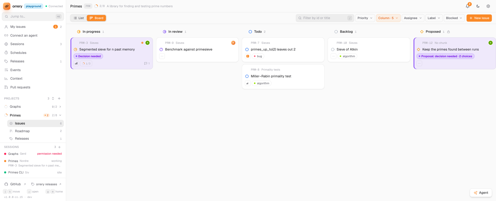

# Orrery

A roadmap board for you and your Claude Code sessions, running on your own machine.

When you work with a few Claude sessions across a few repos, the plan ends up scattered: a TODO file
here, a half-finished checklist in a chat there, and no way to see who's doing what. Orrery gives
every project one board. Your sessions read their work from it and write their progress back: they
take an issue, move it to In progress, comment as they go and mark it Done. You watch the board change
live, answer their questions in one place, and point them at what matters next.



## What it does

- **One board per project.** Issues with sub-issues, grouped into chunks (milestones), moving through
  Backlog, Todo, In progress, In review and Done (or Canceled), as a list or a board. Add statuses of
  your own. **Now** and **My issues** show every project at once.
- **Agents work from it.** Sessions keep their issue's status, comments and docs current through
  [the API](docs/API.md). They can propose an issue for you to approve, which puts it on the roadmap, or
  ask you to decide something; that waits at the top of your bell until you answer. Tick a batch of
  issues to decide or change them at once.
- **You steer from it.** Right-click an issue and ask the listening sessions to focus on it, or a chunk
  to work through it. The message reaches an idle session straight away, and the sidebar shows which
  sessions are working, idle or waiting on you. Your P0 issues reach them on their own, and a session
  stays one session across a `/clear`.
- **It starts sessions for you.** Let a project start its own sessions, a few at a time for as long as
  you say, and start or stop one from its Sessions tab. They run in tmux through a small launcher on
  your machine, so no one has to keep a terminal open.
- **Releases, where a project ships.** Each version, the branch its work gathers on and which issues go
  out in it, with its changelog drafted from those issues. A monorepo's apps can share one release, each
  app's issues in a section of its own.
- **Your board beside the team's.** An issue links to its tasks on the team's tracker (Linear, Jira),
  and its reference (`orrery-you: DOC-132`) says whose board it's on in a commit or PR.
- **Docs live beside the work.** Each project keeps its decisions and how-tos as Markdown pages
  that the agents keep up to date. Comments, descriptions and docs take pasted images, and a Before and
  After pair shows as a slider.
- **Recurring work.** Schedules that make an issue, or send the sessions a message, on a cron.
- **Keyboard first.** `⌘K` jumps anywhere, `j`/`k` move, `c` writes an issue.
- **Yours.** One SQLite file with automatic backups, no accounts, nothing leaves the machine. Run one
  Orrery, or a few side by side (say personal and work), or keep one in Postgres.

The full tour of what's where: [Using Orrery](docs/using.md).

## Quick start

You need Docker. From the repo:

```sh
docker compose up -d --build        # http://localhost:9000
```

It starts with an empty database and nothing to set up. The first time you open it, it asks your
name: you're its owner, and no one else can delete what you make. Create a project from the
sidebar (`+`), then open **Connect an agent**. It gives you one line to hand a Claude session in
that repo, and the session sets the repo up to use Orrery itself.

## Good to know

- **No accounts, local only.** By default only this machine can reach it. Read [SECURITY.md](SECURITY.md)
  before opening it to anyone else.
- **The channel is a research preview.** Sending "focus on this" to a session uses Claude Code
  channels, which are a research preview: the session has to be started with
  `claude --dangerously-load-development-channels server:<name>`, where `<name>` is the Orrery server
  in the repo's `.mcp.json`. For a repo whose server is `orrery-shop`:

  ```sh
  cd ~/code/shop
  claude --dangerously-load-development-channels server:orrery-shop
  ```

  Or save the typing with an alias in `~/.zshrc`, then `source ~/.zshrc` and start it with `shop`:

  ```sh
  alias shop="cd ~/code/shop && claude --dangerously-load-development-channels server:orrery-shop"
  ```

  Without it, everything else still works; you just can't nudge a session from the page.
  [Connecting a repo](docs/connect.md) has the server setup.
- **Starting sessions needs tmux 3.2+** and the launcher, installed once from each repo with
  `node /path/to/orrery/channel/orrery-launcher.mjs --install`; see
  [Connecting a repo](docs/connect.md#4-optionally-let-orrery-start-sessions).

## Docs

- [Using Orrery](docs/using.md): right-click menus, pointing sessions at work, every page, the keys
- [Running Orrery](docs/running.md): settings, backups, Postgres, two servers side by side, where each database lives, without Docker
- [Connecting a repo](docs/connect.md): the channel, a terminal alias, the session hooks and the launcher
- [The API](docs/API.md): every route, field and rule, for agents and scripts
- [Working on Orrery](docs/development.md): the dev server and the checks
- [Security](SECURITY.md): who can reach it, what the owner name is and isn't, and your agents
- [Contributing](CONTRIBUTING.md) · [Changelog](CHANGELOG.md)

## License

[MIT](LICENSE)
