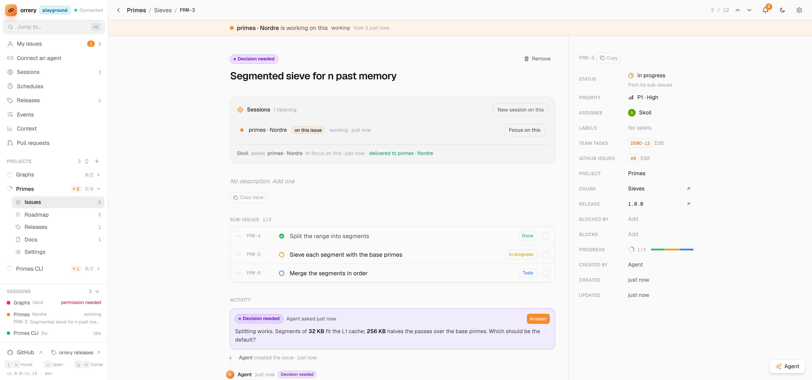
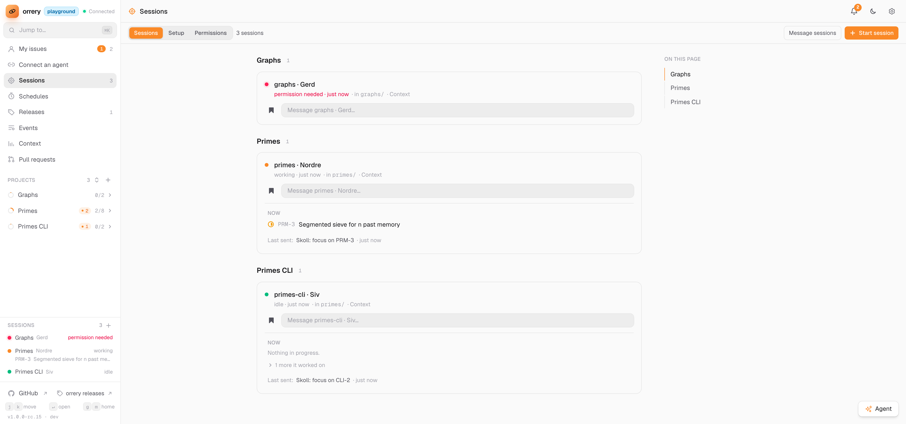
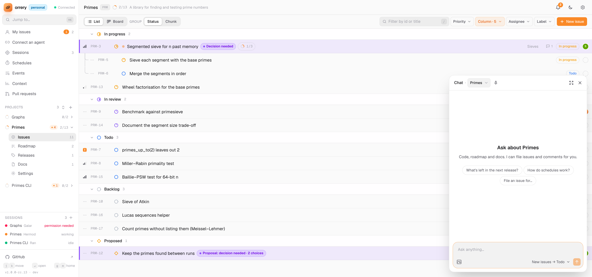
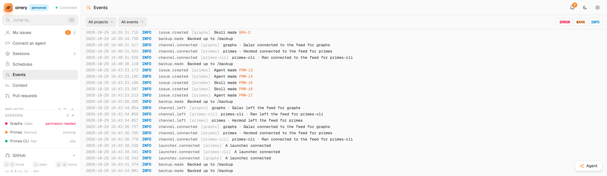

# Orrery

A self-hosted roadmap board for working with Claude Code sessions. Each project has issues, chunks
(milestones), releases and docs. Sessions read and update them through an HTTP API or MCP tools, and
the owner directs sessions from the board. It runs locally, in Docker, on SQLite or Postgres.


## Features

- **Issues:** sub-issues to any depth, grouped into chunks, shown as a list or a board. The statuses
  are configurable, and every change is kept as activity. **My issues**, the home page, spans all projects.
- **Agent access:** a JSON API, MCP tools (`issue`, `start_issue`, `comment`, `finish_issue`, …) and
  `/llms.txt`. Agents can propose issues for the owner to approve, and ask for a decision or feedback.
- **Directing sessions:** through a Claude Code channel, the owner can ask a session to focus on an
  issue, work through a chunk, or read a message. Hooks report whether each session is working, idle
  or waiting. Only one session can work on an issue at a time, and its page shows who's on it.
- **Starting sessions:** optionally, a launcher on the host starts Claude sessions in tmux when work
  arrives with nobody listening, or when you start one, within limits set on the Sessions page.
- **Presets:** standing words a session is started or messaged with. orrery ships Release, Security audit, Review and
  Debug an error; you write the rest.
- **Schedules:** at a time or when something happens (an issue moves, a release is frozen, an error), make an
  issue, send the sessions a message, or start a session.
- **Chat:** Claude on every page, about the project you're on, with no terminal. It answers from the code, roadmap and
  docs, files and edits issues, messages your sessions for you, and asks before it changes a setting.
- **Releases:** versions with their issues and a drafted changelog, shared across a monorepo's projects
  if wanted.
- **Docs:** Markdown pages for each project. Comments and descriptions accept images.
- **Secrets:** API keys that agents use through Orrery's egress, without ever seeing the value.
- **Event log:** orrery's errors and each change to the roadmap, and with Advanced on what it did, kept on the machine,
  on an Events page that sessions can read too.
- **Storage:** one SQLite file or Postgres, both backed up automatically, picked when you first open it or moved to
  later from App settings. There are no accounts; the first name given becomes the owner.

[Using Orrery](docs/using.md) describes each page, menu and shortcut. A session in any connected repo can ask the same
through the `guide` tool.

<table>
<tr>
<td width="50%"></td>
<td width="50%"></td>
</tr>
<tr>
<td></td>
<td></td>
</tr>
</table>

## Quick start

You need:

- **Docker**, which runs Orrery itself
- **Node 24 and pnpm**: the channel, hooks and launcher that connect Claude sessions run from this repo on your
  machine, outside Docker
- **Claude Code**
- **tmux 3.2+**, only if Orrery should start sessions itself

1. Get the repo and its packages (the connected repos run the channel from here, so keep it where it is):

   ```sh
   git clone https://github.com/steffendybvik/orrery.git && cd orrery
   pnpm install
   ```

2. Start Orrery:

   ```sh
   docker compose up -d --build        # http://localhost:9000
   ```

3. Open it and give your name (that makes you the owner). It opens on **Getting started**, which ticks off the
   steps below as they happen. Create a project there or from the sidebar (`+`).
4. Paste the line Getting started (or **Connect an agent**) gives you into a Claude session in that
   project's repo. The session writes the repo's `.mcp.json`, hooks and `CLAUDE.md` section itself.
5. From then on, start Claude in that repo with the channel, so Orrery can send it work:

   ```sh
   claude --dangerously-load-development-channels server:orrery-personal
   ```

   The name after `server:` is the one in the repo's `.mcp.json`; Connect shows it. A shell alias saves typing it
   (see [Connecting a repo](docs/connect.md#2-add-the-channel)).

## Requirements and limits

- **Local by default.** Only this machine can reach it. Read [SECURITY.md](SECURITY.md) before
  exposing it.
- **Channels are a Claude Code research preview**, hence the long flag in step 5. Without it a session still
  has the tools and can read and update the roadmap, but Orrery can't send it work.
- **Starting sessions** needs tmux 3.2 or newer, and the launcher installed once per repo
  (`node /path/to/orrery/channel/orrery-launcher.mjs --install`).

## Documentation

- [Using Orrery](docs/using.md): pages, menus, directing sessions, keys
- [Running Orrery](docs/running.md): configuration, backups, Postgres, several instances, running without Docker
- [Connecting a repo](docs/connect.md): the MCP server and channel, hooks, the launcher
- [API](docs/API.md): every route and field
- [Development](docs/development.md): where things are, the dev server and checks
- [UI components](docs/components.md): the kit and shared pieces the page is built from
- [Security](SECURITY.md) · [Contributing](CONTRIBUTING.md) · [Changelog](CHANGELOG.md)

## License

[MIT](LICENSE)
